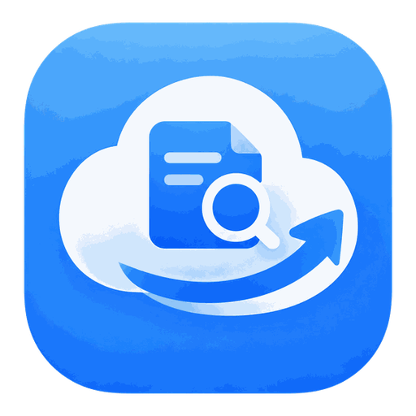
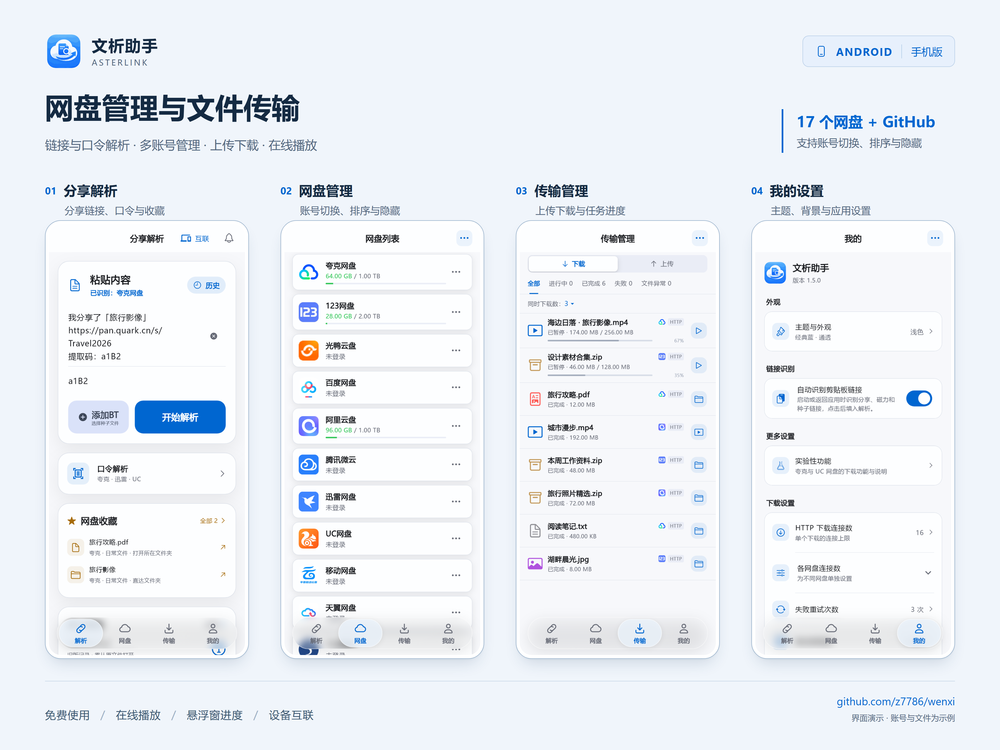
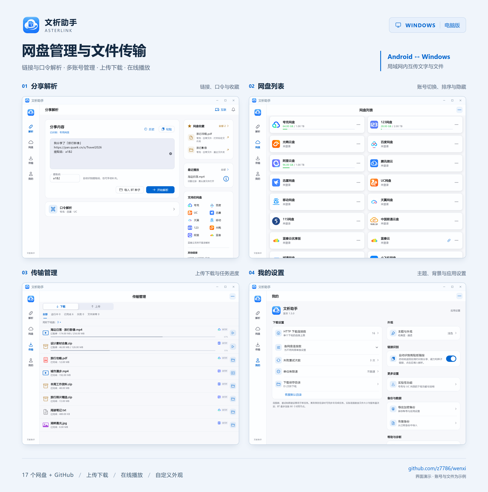
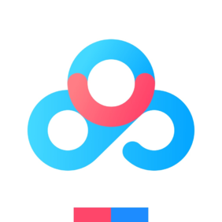
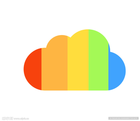

  
  <h1>文析助手 · AsterLink</h1>
  
把网盘放在一起，让解析、管理与传输更简单。

  

    
    
    
  

  

    <a href="#安卓界面">安卓界面</a> · <a href="#windows-界面">Windows 界面</a> · <a href="#支持网盘">支持网盘</a> · <a href="#功能">功能</a> · <a href="#下载">下载</a> · <a href="docs/BUILDING.md">编译</a> · <a href="CHANGELOG.md">更新记录</a>
  

## 项目介绍

**文析助手（AsterLink）** 是一款面向 **Android 和 Windows** 的免费网盘管理与文件传输应用，已接入 **17 个网盘和 GitHub 文件源**。

粘贴分享链接或口令，就能查看文件、下载或在线播放；登录账号后，还可以搜索网盘、上传文件、整理目录，把常用文件和分享收藏起来。下载与上传集中在「传输」页，手机与电脑可通过局域网互传文字和文件，主题、毛玻璃效果与背景也能按自己的习惯调整。

## 安卓界面

四个主页面的当前界面预览，账号、文件与任务均为演示数据。点击图片可查看高清宣传图。

单页原图：[分享解析](docs/images/android-parse.png) · [网盘管理](docs/images/android-clouds.png) · [传输管理](docs/images/android-downloads.png) · [我的设置](docs/images/android-settings.png)

## Windows 界面

桌面端使用侧边导航与宽屏布局，展示相同的四个主页面。

单页原图：[分享解析](docs/images/windows-parse.png) · [网盘列表](docs/images/windows-clouds.png) · [传输管理](docs/images/windows-downloads.png) · [我的设置](docs/images/windows-settings.png)

## 支持网盘

**17 个网盘 + GitHub 文件源**，其中 **15 个网盘支持分享链接解析**；GitHub 另支持仓库文件与 Releases 链接。

<table>
  <tr>
    <td align="center" width="33%"> <strong>夸克网盘</strong></td>
    <td align="center" width="33%"> <strong>UC 网盘</strong></td>
    <td align="center" width="33%"> <strong>迅雷云盘</strong></td>
  </tr>
  <tr>
    <td align="center"> <strong>百度网盘</strong></td>
    <td align="center"> <strong>123 云盘</strong></td>
    <td align="center"> <strong>中国移动云盘</strong></td>
  </tr>
  <tr>
    <td align="center"> <strong>天翼云盘</strong></td>
    <td align="center"> <strong>光鸭云盘</strong></td>
    <td align="center"> <strong>阿里云盘</strong></td>
  </tr>
  <tr>
    <td align="center"> <strong>蓝奏云</strong></td>
    <td align="center"> <strong>中国联通云盘</strong></td>
    <td align="center"> <strong>115 网盘</strong></td>
  </tr>
  <tr>
    <td align="center"> <strong>城通网盘</strong></td>
    <td align="center"> <strong>蓝奏云优享版</strong> 仅个人网盘管理</td>
    <td align="center"> <strong>腾讯微云</strong> 仅个人网盘管理</td>
  </tr>
  <tr>
    <td align="center"> <strong>小飞机网盘</strong></td>
    <td align="center"> <strong>PikPak</strong></td>
    <td align="center"> <strong>GitHub 文件源</strong> 仓库文件与发布附件</td>
  </tr>
</table>

网盘列表支持自定义排序和隐藏，账号可自定义名称并保留配置。蓝奏云优享版与腾讯微云目前提供个人文件管理，暂不支持分享链接解析；文件操作和下载能力以对应平台与账号权限为准。

## 功能

| 功能 | 可以做什么 |
| --- | --- |
| **链接与口令解析** | 识别完整分享文案、提取码与多条链接，保留解析历史；夸克、迅雷、UC 提供独立口令入口，选择平台后解析并进入文件列表。 |
| **多网盘、多账号** | 快速切换账号、自定义账号名称，查看和复制该账号的登录信息；下载、播放与收藏保留账号归属。 |
| **文件管理与搜索** | 列表或网格浏览，显示文件日期，支持多选、上传、新建文件夹及平台允许的重命名、移动、删除与分享；独立搜索页支持类型筛选、搜索历史及子目录搜索。 |
| **存储空间切换** | 阿里云盘可切换资源库、备份盘与相册；支持的移动、天翼和联通账号可浏览家庭云。 |
| **统一下载管理** | 支持网盘文件、HTTP / HTTPS、磁力链接与 BT 种子，提供暂停、继续、失败重试、批量操作及连接数、任务数和限速设置。 |
| **后台上传** | 文件上传独立排队，离开文件页面仍可继续；在「传输 → 上传」查看进度、取消或重试，Android 通知栏显示传输状态。 |
| **预览与在线播放** | 预览图片、文本和音视频；播放器支持断点续播、播放列表、倍速、音轨与字幕、截图、定时停止、画面比例和字幕外观设置。安卓端可选择第三方播放器，支持的任务可边下边播。 |
| **设备互联** | 同一局域网内互传文字、链接、文件和文件夹，支持扫码连接、选择已连接设备发送、收件箱回复，以及限时文件链接与二维码分享。 |
| **安卓传输悬浮窗** | 同时查看下载、上传进度，支持拖动、调整宽高和收起为悬浮球；闲置 3 秒自动贴边半隐藏。 |
| **收藏与重命名** | 收藏分享链接、文件和文件夹，自定义收藏名称；保留提取码，快速重新解析分享或定位文件目录。 |
| **主题与背景** | 五套配色、三种玻璃效果，支持浅色、深色和跟随系统；自定义日夜背景、亮度、模糊和卡片透明度，分别记住手机与电脑的裁剪位置。 |
| **备份与恢复** | 使用密码加密导出账号、设置和收藏，换设备或重装后恢复；可选择同时携带背景图片。 |
| **消息公告** | 在解析页查看多条远程图文公告，支持 Markdown 排版、置顶与已读管理；详见 [公告配置说明](docs/ANNOUNCEMENTS.md)。 |

不同网盘的接口、账号权益和网络环境会影响下载速度与功能可用性，连接数也会按平台限制调整。设备互联在手机端手动开启，Windows 进入页面后自动开启并展示可放大的连接二维码。

## 使用

1. **管理网盘**：需要浏览个人文件时，在“网盘”页选择平台并登录；按需调整排序、隐藏平台或添加多个账号。
2. **解析分享**：在“解析”页粘贴链接或完整分享文案，核对提取码后开始解析；中文口令从“口令解析”入口选择对应网盘。
3. **选择操作**：浏览文件并下载或预览；点击文件列表顶部的星标，可以收藏整个分享。
4. **管理任务**：在“传输”页切换下载和上传任务，查看进度并进行暂停、取消、重试等操作；安卓端也可手动开启传输悬浮窗。

## 下载

在 [Releases](https://github.com/z7786/wenxi/releases) 页面获取安装包。

| 平台 | 安装包 | 系统要求 |
| --- | --- | --- |
| Android | arm64 APK | Android 7.0 及以上 |
| Windows | x64 安装包 | Windows 10 / 11 |

## 编译与反馈

使用 Flutter 3.41.4、Dart 3.11.1 和 Go 1.24.7，详见 [编译说明](docs/BUILDING.md)。

问题和建议欢迎提交 **Issues**，请附上版本、系统、操作步骤及脱敏错误提示，不要上传账号密码、Cookie 或账号备份。

项目采用 [AGPL-3.0](LICENSE)，基于 Flutter、Gopeed 和 media_kit 构建。第三方组件保留各自许可，网盘名称及标识归对应服务所有，本项目并非网盘官方客户端。

[发布说明](docs/GITHUB-PUBLISH.md) · [隐私说明](docs/PRIVACY.md) · [第三方声明](assets/licenses/THIRD_PARTY_NOTICES.md) · [许可证范围](docs/LICENSING.md)
